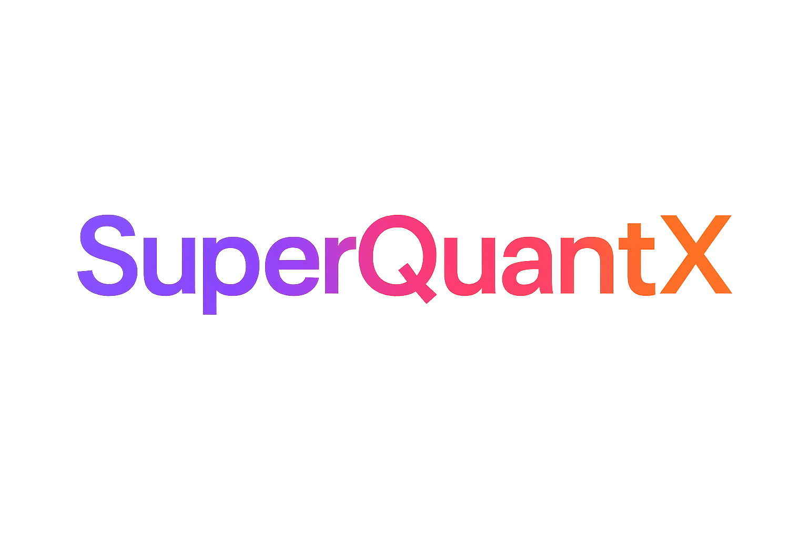

[](https://pypi.org/project/superquantx/)
[](https://pypi.org/project/superquantx/)
[](https://opensource.org/licenses/Apache-2.0)
[](https://github.com/SuperagenticAI/superquantx/actions/workflows/ci.yml)
[](https://superagenticai.github.io/superquantx)
[](https://github.com/astral-sh/ruff)

# SuperQuantX

**One API across quantum SDKs, with a classical baseline for every result.**

SuperQuantX is an experimental, open-source toolkit for quantum machine
learning and optimisation research by [Superagentic AI](https://super-agentic.ai).
The same circuits and algorithms run on PennyLane, Qiskit, Cirq, Amazon
Braket, pytket and a built-in simulator, and every algorithm reports a
classical reference so you can see whether the quantum part earns its keep.

> 📖 **[Documentation](https://superagenticai.github.io/superquantx/)** ·
> 🎬 **[Showcase with real output](docs/showcase.md)**

<div align="center">
  <a href="https://super-agentic.ai" target="_blank">
    
  </a>
</div>

> **Research software.** Everything below runs on classically simulated
> quantum circuits. Nothing here demonstrates quantum advantage, and the
> library is designed to tell you when a quantum model does not beat a
> classical one.

## What works today

| Backend | Runs on | Status |
|---------|---------|--------|
| `simulator` | built-in NumPy statevector | ✅ tested |
| `pennylane` | `default.qubit` | ✅ tested |
| `qiskit` | Qiskit Aer | ✅ tested |
| `cirq` | Cirq simulator | ✅ tested |
| `braket` | Amazon Braket `LocalSimulator` | ✅ tested |
| `tket` | pytket local simulator | ✅ tested |
| `ocean` | D-Wave Ocean (QUBO/Ising only) | ⚠️ annealing only, hardware needs a Leap token |
| IBM Quantum, Braket devices (IonQ, Rigetti), Quantinuum H-Series | via `qiskit`, `braket`, `tket` | ⚠️ untested, needs your own credentials |
| Azure Quantum, Rigetti Forest, cuQuantum, TensorFlow Quantum | | 🚧 planned, not implemented |

"Tested" means the unit tests run a Bell state, a qubit-order check, exact
expectation values and the fidelity kernel on that backend. Check your own
install with `superquantx list-backends`.

| Algorithm | Classical check it reports |
|-----------|----------------------------|
| `VQE` (RealAmplitudes, EfficientSU2) | exact ground energy (H2 STO-3G built in) |
| `QAOA` for MaxCut | brute-force optimum and approximation ratio |
| `QuantumSVM` (fidelity kernel) | tuned RBF SVM and logistic regression via `compare_to_classical` |
| `QuantumNN` (parameter-shift gradients) | `compare_to_classical` works with any sklearn-style classifier |
| `QuantumPortfolioAgent` (CVaR-VQE) | brute-force optimal selection and a Markowitz reference |
| `QuantumClassificationAgent` | `compare_to_classical` verdict and p-value |

## Quick start

```bash
git clone https://github.com/SuperagenticAI/superquantx.git
cd superquantx
uv sync --extra all-backends      # or: pip install -e ".[all-backends]"

uv run superquantx list-backends  # Bell-state check on every backend
uv run python examples/showcase.py
```

Install the 0.3.0 release from PyPI (Python 3.11+):

```bash
pip install "superquantx==0.3.0"                     # built-in simulator
pip install "superquantx[mcp,qiskit,pennylane]==0.3.0"  # MCP and SDKs
```

### AI assistants and automatic encodings

The [MCP server](docs/mcp.md) exposes six tools over stdio for circuits,
backend checks, classification and MaxCut. Start it with `superquantx-mcp`
or `python -m superquantx.mcp` from your MCP client.

`QuantumSVM(backend="simulator", feature_map="auto")` selects an implemented
encoding at fit time using a local heuristic. The optional Qmes recommender
is installed separately; see the [design and limitations](docs/design/qmes-feature-map-auto.md).
Inspect `selected_feature_map_` and `feature_map_recommendation_` after fitting.

### A quantum classifier, honestly benchmarked

```python
import superquantx as sqx
from sklearn.datasets import make_moons

X, y = make_moons(n_samples=100, noise=0.2, random_state=0)
result = sqx.compare_to_classical(X, y, sqx.QuantumSVM(backend="pennylane"), cv=5)
print(result.table())
```

```text
model                                      accuracy  wall time  grid  QPU circuits
----------------------------------------------------------------------------------
QuantumSVM (PennyLane), tuned       0.930 +/- 0.051      3.43s    25       119,000
QuantumSVM (PennyLane), untuned     0.670 +/- 0.125      0.58s     1             -
SVC (RBF), tuned C and gamma        0.950 +/- 0.055      0.85s    25             -
Logistic regression, tuned C        0.860 +/- 0.097      0.19s     4             -
----------------------------------------------------------------------------------
100 samples, 2 features, 5-fold stratified CV (identical folds for every model), seed=0
quantum minus best classical: -0.020; no significant difference from SVC (RBF), tuned C and gamma (p=0.54)
```

This follows the protocol of
[arXiv:2610.42029](https://arxiv.org/abs/2610.42029): equal tuning budgets,
identical folds, per-fold preprocessing and the Nadeau-Bengio corrected
t-test. As that paper reports, a tuned quantum kernel is statistically
indistinguishable from a tuned RBF SVM here, and bandwidth tuning (0.67 to
0.93) matters more than the circuit. See
[Benchmarking](docs/user-guide/benchmarking.md).

### VQE and QAOA with exact answers

```python
import numpy as np
import superquantx as sqx

vqe = sqx.create_vqe_for_molecule("H2", backend="qiskit")
print(vqe.find_ground_state(), vqe.exact_ground_energy())   # both -1.857275 Ha

W = np.array([[0, 1, 1, 0, 1], [1, 0, 1, 1, 0], [1, 1, 0, 1, 0],
              [0, 1, 1, 0, 1], [1, 0, 0, 1, 0]], dtype=float)
r = sqx.QAOA(backend="cirq", p=2, seed=7).solve(W)
print(r["cut_value"], r["classical_optimum"], r["approximation_ratio"])
```

### Agents that show their work

```python
import numpy as np
import superquantx as sqx

returns = np.random.default_rng(0).normal(0.01, 0.02, size=(250, 6))
res = sqx.QuantumPortfolioAgent(backend="simulator", n_select=3, seed=0).solve(returns)
print(res.result["selected_assets"], res.result["classical_selected_assets"],
      res.result["matches_classical_optimum"])
```

`examples/quantum_agents_demo.py` runs the portfolio and classification
agents end to end.

## Command line

```bash
superquantx -v version        # versions of installed backend SDKs
superquantx list-backends     # real Bell-state check per backend
superquantx benchmark -d moons -b pennylane   # quantum kernel vs tuned classical
superquantx run qsvm --data iris -b simulator
```

## Development

```bash
uv sync --extra all-backends --extra dev
uv run pytest tests/unit tests/integration
uv run ruff check src tests
```

Contributions are welcome: [open an issue](https://github.com/SuperagenticAI/superquantx/issues)
or read the [contributing guide](docs/development/contributing.md).
Python 3.11+ is required; see [backend compatibility](docs/BACKENDS.md#backend-version-compatibility)
for version floors.

## License

Apache License 2.0. See [LICENSE](LICENSE).

<div align="center">

*Built by [Superagentic AI](https://super-agentic.ai)*

</div>
