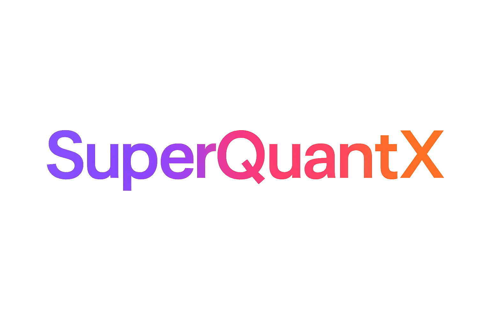

# SuperQuantX Documentation

<div class="hero-banner">
  <h1 class="superquant-gradient">SuperQuantX</h1>
  <h2 class="superquant-gradient">The agentic layer for Quantum AI</h2>
  <p>An open software layer across quantum SDKs, with a classical baseline for every result.</p>
</div>

## Welcome to SuperQuantX

!!! tip "Website"
    New here? Start at **[superquantx.dev](https://superquantx.dev)** for an overview, the
    [supported backends](https://superquantx.dev/backends) and the
    [MCP server setup](https://superquantx.dev/mcp).

```bash
uv add "superquantx==0.3.0"
```

SuperQuantX is an experimental, open-source toolkit for quantum machine
learning and optimisation research. One API runs the same circuits and
algorithms on PennyLane, Qiskit, Cirq, Amazon Braket, pytket and a built-in
simulator, and every result comes with a classical reference so you can see
whether the quantum part earns its keep.

### Key features

- **One API, six gate-model backends**: identical circuits, bit order
  normalised across SDKs.
- **Algorithms with built-in checks**: VQE reports the exact ground energy,
  QAOA reports the brute-force optimum, classifiers can be benchmarked with
  [`compare_to_classical`](user-guide/benchmarking.md).
- **Benchmarking protocol**: equal tuning budgets, identical folds and
  a corrected t-test, following [arXiv:2610.42029](https://arxiv.org/abs/2610.42029).
- **Agents that show their work**: portfolio and classification agents
  return the classical optimum or baseline alongside the quantum answer.

<div align="center">
  
</div>

### What works today

| Backend | Status |
|---------|--------|
| Built-in simulator | tested |
| PennyLane (`default.qubit`) | tested |
| Qiskit (Aer) | tested |
| Cirq simulator | tested |
| Amazon Braket `LocalSimulator` | tested |
| pytket local simulator | tested |
| D-Wave Ocean | QUBO/Ising only |
| IBM Quantum, Braket devices, Quantinuum hardware | untested, needs your own credentials |
| Azure Quantum, Rigetti Forest, cuQuantum, TensorFlow Quantum | planned, not implemented |

See the [Showcase](showcase.md) for real output from every tested backend.

## Quick Start

Get started with SuperQuantX in minutes:

```python
import superquantx as sqx

# Choose your backend
backend = sqx.get_backend('simulator')

# Create a quantum circuit
circuit = backend.create_circuit(n_qubits=2)
circuit = backend.add_gate(circuit, 'H', 0)  # Hadamard gate
circuit = backend.add_gate(circuit, 'CNOT', [0, 1])  # CNOT gate
circuit = backend.add_measurement(circuit)

# Execute the circuit
result = backend.execute_circuit(circuit, shots=1024)
print(f"Results: {result['counts']}")
```

## Navigation

<div class="grid" markdown>

<div markdown>
### 📚 Getting Started
Learn the basics and get up and running quickly.

- [Installation Guide](getting-started/installation.md)
- [Quick Start](getting-started/quickstart.md)
- [First Program](getting-started/first-program.md)
- [Configuration](getting-started/configuration.md)
</div>

<div markdown>
### 👨‍💻 User Guide
Comprehensive guides for using SuperQuantX.

- [Platform Overview](user-guide/overview.md)
- [Quantum Backends](user-guide/backends.md)
- [Algorithm Guide](user-guide/algorithms.md)
</div>

<div markdown>
### 🧪 Tutorials
Hands-on tutorials and examples.

- [Basic Quantum Computing](tutorials/basic-quantum.md)
- [Quantum Machine Learning](tutorials/quantum-ml.md)
</div>

<div markdown>
### 📖 API Reference
Complete API documentation.

- [Core API](api/core.md)
- [Backends](api/backends.md)
- [Algorithms](api/algorithms.md)
- [Circuits](api/circuits.md)
- [Agents](api/agents.md)
</div>

<div markdown>
### 📏 Results
Real output, checked against classical baselines.

- [Showcase](showcase.md)
- [Benchmarking against classical baselines](user-guide/benchmarking.md)
</div>

</div>

## Research Areas

SuperQuantX accelerates research in:

- **Quantum Machine Learning**: QSVM, QNN, quantum feature maps
- **Quantum Optimization**: QAOA, VQE (including CVaR-VQE), quantum annealing via D-Wave Ocean
- **Quantum Agents**: Portfolio and classification agents with classical checks
- **Classical baselines**: Tuned classical baselines and significance tests for every quantum model

## Community & Support

- 📧 **Email**: research@super-agentic.ai
- 🐛 **Issues**: [GitHub Issues](https://github.com/SuperagenticAI/superquantx/issues)
- 💬 **Discussions**: [GitHub Discussions](https://github.com/SuperagenticAI/superquantx/discussions)
- 📖 **Source Code**: [GitHub Repository](https://github.com/SuperagenticAI/superquantx)

---

<div align="center">
  <p><strong>Built with ❤️ for the Quantum AI research community</strong></p>
  <p><em>Developed by <a href="https://super-agentic.ai">Superagentic AI</a></em></p>
</div>
